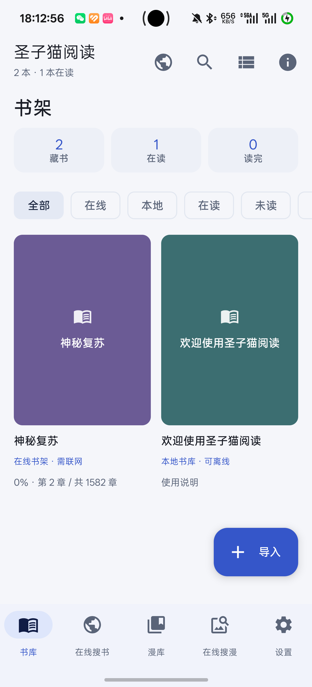
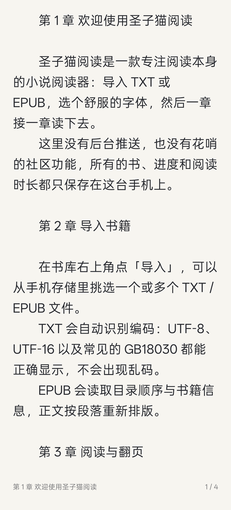
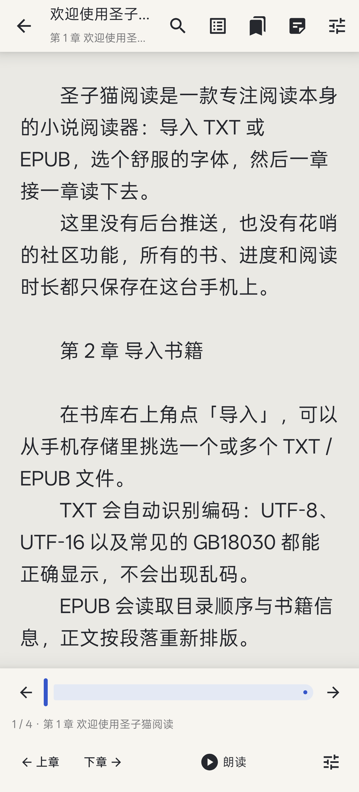
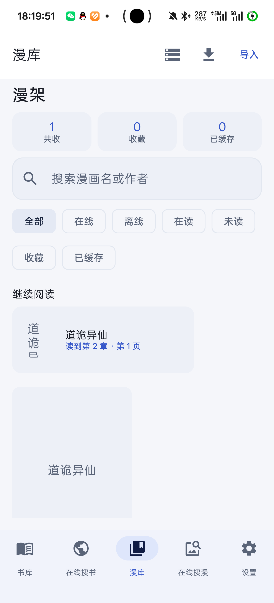
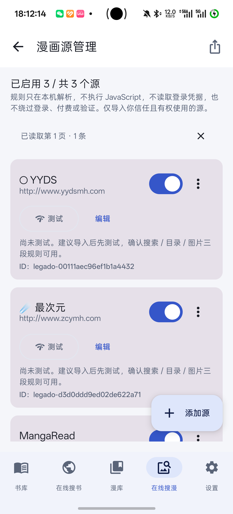
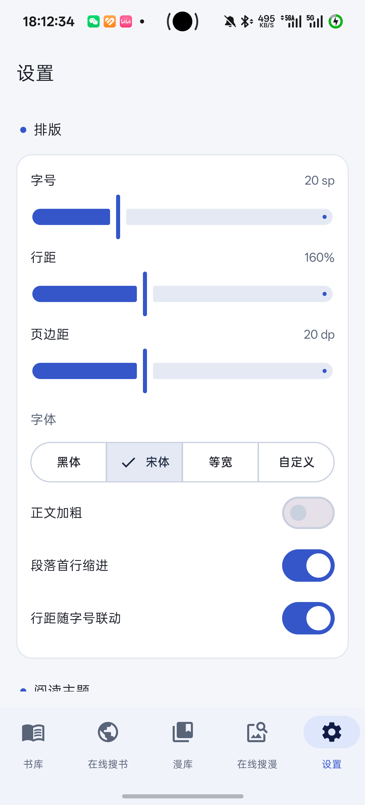
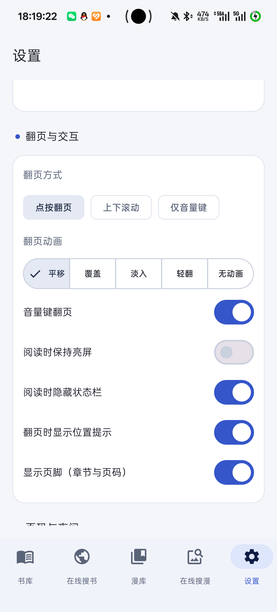

# 圣子猫阅读 · 手机版 1.7.0 — 功能与 UI 评审

评审对象：`com.shengzimao.reader.mobile` 1.7.0（versionCode 12），真机 realme RMX5010 / Android 16。
评审方式：源码通读（`mobile-reader/app/src/main/java/**`）+ 真机截图（``*.png`（本目录）`）。所有结论标注文件与行号；未在代码或真机中确认的，明确标注「未确认」。

---

## 0. 一句话结论

功能面已经很宽（离线+在线 × 小说+漫画 四条链路都通了），**当前短板不在"缺功能"，而在三类问题**：

1. **有设置项但改不动 / 没有入口**（`tapZone`、`edgeGesture`、自定义字体导入、行距联动），以及**有 UI 但点了没反应**（漫画进度条拖拽、音量键）。
2. **在线链路是"半个阅读器"**：在线小说只有滚动+上/下一章，缺分页、TTS、书签、划线、全文搜索；在线书架的书**永远无法追更、无法刷新目录**。
3. **写盘与状态恢复**：每次翻页/滚动都全量重写 `library.json`（内联完整目录），且退到后台不保存进度、进程重建回书库首页。

修完 P0（约 10 项、都是小改动）体感提升远大于加新功能。

---

## 1. 功能地图（现状家底）

| 维度 | 离线小说 | 在线小说 | 离线漫画 | 在线漫画 |
| --- | --- | --- | --- | --- |
| 入口 | 书库 | 在线搜书 / 书架在线条目 | 漫库 | 在线搜漫 / 漫库在线条目 |
| 格式 | TXT、EPUB | 聚合书源、番茄 | CBZ、ZIP、散图 | 声明式漫画源（JSON/CSS/XPath） |
| 排版 | 分页+5 动画+字号/行距/字距/缩进/5 底色/自定义色/导入字体 | **仅滚动**，复用字号/行距/字体/底色 | 条漫/横向/日漫 + 4 缩放 + 长图分块 | 同左 |
| 目录 | 检索、正倒序、定位 | 检索（无定位、无倒序） | 检索、当前章高亮 | 同左 |
| 标注 | 划线、笔记、摘录导出、书签、全文搜索 | **全部没有** | 无 | 无 |
| 朗读 | 按段 TTS + 自动翻页 | 无 | 无 | 无 |
| 缓存 | 本地文件 | 无正文缓存，逐章联网 | 本地目录 | 图片缓存（可清理/限额） |
| 进度 | 字符偏移锚点 | 章节下标 + 段落下标 | 章 + 页 | 同左 |
| 追更 | 手动/30 分钟自动 | **入口被隐藏**（见 P0-8） | 无 | 无 |

### 真机截图

| 书库 | 离线阅读（正文 / 菜单） | 在线小说阅读 |
| --- | --- | --- |
|  |   |  |

| 漫库 | 在线搜漫 | 漫画源管理 |
| --- | --- | --- |
|  |  |  |

| 在线搜书 | 下载管理 | 设置 |
| --- | --- | --- |
|  |  |  |

---

## 2. P0 — 必须优先修的缺陷（都是小改动）

### P0-1 朗读（TTS）序号比对用错维度 → 高亮与自动续读基本失效
[ReaderTts.kt:125](../../mobile-reader/app/src/main/java/com/shengzimao/reader/mobile/reader/ReaderTts.kt#L125) 的 `isCurrent(index)` 把**批次计数器** `utteranceSeq` 和**段序号**比较；而 [ReaderTts.kt:165](../../mobile-reader/app/src/main/java/com/shengzimao/reader/mobile/reader/ReaderTts.kt#L165) 的 utteranceId 里带的是段序号。于是第一批只接受 `index==1` 的回调、第二批只接受 `index==2`……
后果：`onSegmentFinished` 多数时候不触发 → 朗读高亮卡住、[ReaderScreen.kt:304](../../mobile-reader/app/src/main/java/com/shengzimao/reader/mobile/ui/ReaderScreen.kt#L304) 的「读完自动翻页」经常不生效。
修法：utteranceId 编成 `szm-<batch>-<index>-<nano>`，`isCurrent` 比对 batch；顺手加单测。

### P0-2 漫画：进度条拖拽与音量键翻页点了没反应
[MangaReaderScreen.kt:280-283](../../mobile-reader/app/src/main/java/com/shengzimao/reader/mobile/ui/MangaReaderScreen.kt#L280-L283) 与音量键回调只写 `currentPage`，但驱动滚动/翻页的 `LaunchedEffect`（[:148](../../mobile-reader/app/src/main/java/com/shengzimao/reader/mobile/ui/MangaReaderScreen.kt#L148)）的 key 不含 `currentPage`，且其内部 `snapshotFlow` 会立刻把值改回真实位置。
后果：拖进度条、按音量键 → 数字闪回、页面不动。
修法：`onSeek`/音量键走 `scrollToItem` / `pager.scrollToPage`（或用 `LaunchedEffect(currentPage)` 单向同步 + 标志位区分来源）。

### P0-3 漫画：放大后长图下半部分永远看不到
`MangaZoomState.contentHeight` 在 [MangaImages.kt:61](../../mobile-reader/app/src/main/java/com/shengzimao/reader/mobile/ui/MangaImages.kt#L61) 声明后**全仓库没有赋值点**，所以纵向平移上限只有一屏；同时放大时 [MangaReaderScreen.kt:347](../../mobile-reader/app/src/main/java/com/shengzimao/reader/mobile/ui/MangaReaderScreen.kt#L347) 把 `userScrollEnabled = false`。
修法：在 `MangaImageTile` 里把整页显示高度写回 `zoom.contentHeight`（`MangaImageInfo.displayHeight(width)` 已有），或放大时保持滚动条可用。

### P0-4 左右各 16% 区域滑动翻页永久失效，且无处关闭
[ReaderSurface.kt:203-204](../../mobile-reader/app/src/main/java/com/shengzimao/reader/mobile/reader/ReaderSurface.kt#L203-L204) 把 x<16% / >84% 的横向拖动判为「调亮度」并直接 return（[:252-255](../../mobile-reader/app/src/main/java/com/shengzimao/reader/mobile/reader/ReaderSurface.kt#L252-L255)）。而 `edgeGesture` 默认 `BRIGHTNESS`（[ReaderSettings.kt:131](../../mobile-reader/app/src/main/java/com/shengzimao/reader/mobile/data/ReaderSettings.kt#L131)），**设置页没有任何控件能改它**（`EdgeGesture.entries` 全仓零引用）。
修法：设置页加「边缘手势：无 / 亮度」；或把亮度手势改为「先拖动后判定，短距离不算边缘」。

### P0-5 两个设置项完全没有 UI（假设置）
- `tapZone`（左右/上下分区）：字段存在（[ReaderSettings.kt:121](../../mobile-reader/app/src/main/java/com/shengzimao/reader/mobile/data/ReaderSettings.kt#L121)）、[ReaderSurface.kt:141](../../mobile-reader/app/src/main/java/com/shengzimao/reader/mobile/reader/ReaderSurface.kt#L141) 在用，但 `TapZone.entries` 全仓无 UI → 永远 LEFT_RIGHT。
- `edgeGesture`：同上。
修法：设置页「翻页与交互」补两组 FilterChip（约 20 行）。

### P0-6 设置页字号滑杆绕过「行距随字号联动」
[SettingsScreen.kt:113](../../mobile-reader/app/src/main/java/com/shengzimao/reader/mobile/ui/SettingsScreen.kt#L113) 用 `s.copy(fontSize = …)`，而阅读页面板 [ReaderSettingsSheet.kt:81](../../mobile-reader/app/src/main/java/com/shengzimao/reader/mobile/ui/ReaderSettingsSheet.kt#L81) 用 `ReaderSettings.withFontSize`。
后果：开关开着，在设置页调字号行距不跟随。
修法：改成 `ReaderSettings.withFontSize(s, it.toInt())`。

### P0-7 进度只在 `onDispose` 保存 → 切后台被杀就丢
[ReaderScreen.kt:354-358](../../mobile-reader/app/src/main/java/com/shengzimao/reader/mobile/ui/ReaderScreen.kt#L354-L358) 注释写「切到后台/退出阅读页时保存」，但实现只有 `onDispose`，没有任何 `ON_STOP` 钩子；唯一的周期写入是 [ReaderScreen.kt:205-214](../../mobile-reader/app/src/main/java/com/shengzimao/reader/mobile/ui/ReaderScreen.kt#L205-L214) 的 `recordReading`，**它不写 position**。
修法：`LifecycleEventObserver` 监听 `ON_STOP` → `savePosition`。

### P0-8 在线书架的书永远无法追更 / 刷新目录
[LibraryScreen.kt:584](../../mobile-reader/app/src/main/java/com/shengzimao/reader/mobile/ui/LibraryScreen.kt#L584) 的追更入口要求 `!book.onlineOnly`，而在线书架条目就是 `onlineOnly = true`（[ReaderViewModel.kt:664-667](../../mobile-reader/app/src/main/java/com/shengzimao/reader/mobile/ui/ReaderViewModel.kt#L664-L667)）；`onlineManifest` 只在加入时写一次，之后**没有任何刷新路径**。

即使放开 UI 入口也仍然走不通：`updateOne` 第一行就要 `store.exists(book)`（[OnlineController.kt:427](../../mobile-reader/app/src/main/java/com/shengzimao/reader/mobile/ui/OnlineController.kt#L427)），而 `exists` 要求 `book.file` 非空且文件存在（[LibraryStore.kt:74](../../mobile-reader/app/src/main/java/com/shengzimao/reader/mobile/data/LibraryStore.kt#L74)）——在线条目 `file` 恒为空。
后果：源站更新了新章节，在线书架的目录永远停在加入书架那一天。
修法：给在线条目单独一条「只比对目录、不下正文」的追更分支（跳过 `store.exists`），并在书库菜单里暴露「刷新目录」。

### P0-9 按章节「下载导入」会让该书追更永久失效
[OnlineController.kt:300-311](../../mobile-reader/app/src/main/java/com/shengzimao/reader/mobile/ui/OnlineController.kt#L300-L311) 只读取所选章节的正文（`tomato.chapters(selected, …)`），但紧接着 `saveDownloaded(backfill(...), text, details.toc)` 传进去的是**完整目录**；[ReaderViewModel.kt:632](../../mobile-reader/app/src/main/java/com/shengzimao/reader/mobile/ui/ReaderViewModel.kt#L632) 据此把完整目录写进 `onlineManifest`，而正文里只有几章。于是本地章节数 ≠ manifest 章节数，追更比对从此必然失败。

修法：部分下载时给 `Book` 加 `partial = true` 并在追更里跳过，或按章下载只做章节缓存、不落 `onlineManifest`。

### P0-10 书库「导出/导入备份」不含阅读设置，与文档不符
[ReaderViewModel.kt:855](../../mobile-reader/app/src/main/java/com/shengzimao/reader/mobile/ui/ReaderViewModel.kt#L855) 第三个参数写死 `null`，而 [Backup.kt:44](../../mobile-reader/app/src/main/java/com/shengzimao/reader/mobile/data/Backup.kt#L44) 明确支持 settingsJson、[README](../../mobile-reader/README.md#L146) 也写「阅读设置需在本机重新调整」。
修法：要么补上（序列化 `ReaderSettings`/`MangaSettings`），要么把文案统一成「不含设置」。

### 其他一眼可修的
- **「清空阅读历史」不清统计**：[ReaderViewModel.kt:400-407](../../mobile-reader/app/src/main/java/com/shengzimao/reader/mobile/ui/ReaderViewModel.kt#L400-L407) 只把 `lastReadAt` 置 0，`readingSeconds` 原样保留，与对话框文案矛盾。
- **排序按钮无障碍语义错**：[LibraryScreen.kt:152-154](../../mobile-reader/app/src/main/java/com/shengzimao/reader/mobile/ui/LibraryScreen.kt#L152-L154) contentDescription 是「切换视图」，实际只是打开排序菜单。
- **漫画缓存上限每次打开重置为 1024MB**：[MangaScreens.kt:341](../../mobile-reader/app/src/main/java/com/shengzimao/reader/mobile/ui/MangaScreens.kt#L341) 用 `remember { mutableIntStateOf(1024) }`，关掉再开又回 1024，`MangaSettings` 里也没有对应字段 → 需要新增并持久化。
- **漫画图片内存缓存从不释放**：`MangaBitmapCache.clear()` **零调用点**，只进不出；淘汰也不 `recycle()`。
- **漫画「已缓存」口径不一致**：统计头 [MangaScreens.kt:92](../../mobile-reader/app/src/main/java/com/shengzimao/reader/mobile/ui/MangaScreens.kt#L92) 用「有任一缓存」，筛选用「全部章节」，详情用「已缓存 N/M」。

---

## 3. UI / 交互可优化

### 3.1 阅读页（离线小说）
截图 `03` / `04`。

- **首屏等待**：分页期间整屏只有「正在排版 x%」，百万字书要等全书排完（[ReaderScreen.kt:493-503](../../mobile-reader/app/src/main/java/com/shengzimao/reader/mobile/ui/ReaderScreen.kt#L493-L503)）。建议**先排当前章**渲染首屏，其余后台补齐（配合页表落盘）。
- **每次打开整本重排**：`AppContainer.readPositionHint/savePositionHint`（[ReaderApp.kt:36-46](../../mobile-reader/app/src/main/java/com/shengzimao/reader/mobile/ReaderApp.kt#L36-L46)）已写好却**零调用**。把 `signatureFor(...)` + `book.digest` 作 key 缓存页表，第二次打开秒开。
- **每页首行重复缩进**：`Paginator.frames()` 算出了 `PageFrame.indent`（[Paginator.kt:124-125](../../mobile-reader/app/src/main/java/com/shengzimao/reader/mobile/reader/Paginator.kt#L124-L125)），但 `measurePage` 只取 start/end（[ReaderSurface.kt:384-402](../../mobile-reader/app/src/main/java/com/shengzimao/reader/mobile/reader/ReaderSurface.kt#L384-L402)），缩进全靠全局 `TextIndent` → 续行也缩进。`skipIndent` 就是为此写的，**但无调用点**。
- **页脚压字 + 状态栏重叠**：页脚 `align(BottomCenter)` 盖在正文上（[ReaderSurface.kt:348-365](../../mobile-reader/app/src/main/java/com/shengzimao/reader/mobile/reader/ReaderSurface.kt#L348-L365)）；高度只硬编码扣了 22dp（[ReaderScreen.kt:120](../../mobile-reader/app/src/main/java/com/shengzimao/reader/mobile/ui/ReaderScreen.kt#L120)），关掉「隐藏状态栏」后正文顶到状态栏下。
- **「上下滚动」名不副实**：只在抬手瞬间算目标页 `snapTo`（[ReaderSurface.kt:272-281](../../mobile-reader/app/src/main/java/com/shengzimao/reader/mobile/reader/ReaderSurface.kt#L272-L281)），拖动过程不动、无惯性。要么做成真滚动（连续跟手 + fling），要么把文案改成「上下滑整页」。
- **翻页动画只有进入层**：commit 后旧页立刻消失（[ReaderSurface.kt:163-179](../../mobile-reader/app/src/main/java/com/shengzimao/reader/mobile/reader/ReaderSurface.kt#L163-L179)），覆盖/仿真其实是「新页滑入」。真覆盖需要保留上一页快照。
- **手动翻页不停止朗读**：`onPrev/onNext` 只清选区（[ReaderScreen.kt:520-541](../../mobile-reader/app/src/main/java/com/shengzimao/reader/mobile/ui/ReaderScreen.kt#L520-L541)）→ 页面变了但声音还在读旧页。
- **无障碍**：整块画布只有一个 `contentDescription = "阅读区域"`（[ReaderSurface.kt:185](../../mobile-reader/app/src/main/java/com/shengzimao/reader/mobile/reader/ReaderSurface.kt#L185)），TalkBack 无法翻页/呼出菜单。建议加 `customActions`。

### 3.2 在线小说阅读页
截图 `05` / `06`。整个文件只有 [131 行](../../mobile-reader/app/src/main/java/com/shengzimao/reader/mobile/ui/OnlineReaderScreen.kt)，与离线页差距明显：

| 缺什么 | 影响 |
| --- | --- |
| 分页 | 只有 `LazyColumn` 滚动，没有页码、没有翻页动画、没有音量键 |
| TTS / 书签 / 划线 / 摘录 | 全部没有 |
| 全文搜索 | 没有（离线页有） |
| 阅读设置面板 | 没有（只能去全局设置） |
| 沉浸式菜单 | 顶栏底栏**常驻**，与离线页「点中间呼出」的交互割裂 |
| 目录 | 无倒序、无当前章定位、无「上一处/下一处」 |
| 自动重试 / 预取 | 无，每次翻章都干等「正在联网读取」 |

另外两个小 bug：
- [OnlineReaderScreen.kt:62](../../mobile-reader/app/src/main/java/com/shengzimao/reader/mobile/ui/OnlineReaderScreen.kt#L62) `filter { it.isNotBlank() }` **丢掉所有空行**，段落节奏被压平；
- [OnlineReaderScreen.kt:115](../../mobile-reader/app/src/main/java/com/shengzimao/reader/mobile/ui/OnlineReaderScreen.kt#L115) `index == 0` 强制加粗首段 —— 实际是番茄把章节标题拼进正文首行，**治标**。正确做法是让引擎把标题拆出来单独渲染。

> **最有价值的重构方向**：把 `ReaderScreen` 抽成 `ReadingSource`（本地 / 在线），在线页复用分页器、TTS、划线、搜索。这一步做完，上面整张表一次补齐。

### 3.3 书库
截图 `01` / `02`。

- **没有多选**：`deleteBooks` 已实现（[ReaderViewModel.kt:366](../../mobile-reader/app/src/main/java/com/shengzimao/reader/mobile/ui/ReaderViewModel.kt#L366)）但**零 UI 调用**。批量删除/批量追更/批量导出都得一本本来。
- **EPUB 封面导入了却永远不显示**：`saveCover`（[ReaderViewModel.kt:328](../../mobile-reader/app/src/main/java/com/shengzimao/reader/mobile/ui/ReaderViewModel.kt#L328)）、`coverFile`（[LibraryStore.kt:83](../../mobile-reader/app/src/main/java/com/shengzimao/reader/mobile/data/LibraryStore.kt#L83)）都存在，但书库卡片用的是 `coverColor(title)` 哈希取色（[LibraryScreen.kt:658](../../mobile-reader/app/src/main/java/com/shengzimao/reader/mobile/ui/LibraryScreen.kt#L658)），**没有任何读取 covers 目录的代码**。目前所有封面色块都是纯色 + 书名。
- **「收藏」是死功能**：`toggleFavorite` 只在菜单里翻转字段，筛选 chip 里没有「收藏」（[LibraryScreen.kt:221](../../mobile-reader/app/src/main/java/com/shengzimao/reader/mobile/ui/LibraryScreen.kt#L221) 只有 全部/在线/本地/在读/未读/读完）。要么补筛选，要么去掉菜单项。
- **搜索只搜书名+作者**，`Book.tags` / `category` 字段存在但全无 UI。
- **空态文案与实际能力不匹配**：文案说「也可以从在线搜书把书带回来」，但从在线页加入书架后是**在线条目**，本地书库筛选「本地」看不到它。

### 3.4 设置页
截图 `12`–`14`。29 项设置覆盖得不错，问题集中在「写了不生效 / 写了没入口」：

- P0-5 / P0-6 已列。
- **自定义字体没有导入入口**：设置页能选「自定义」（[SettingsScreen.kt:131-137](../../mobile-reader/app/src/main/java/com/shengzimao/reader/mobile/ui/SettingsScreen.kt#L131-L137)），但导入逻辑只在阅读页面板里 → 在设置页点了等于回退宋体。
- **滑杆逐帧写 DataStore**：亮度、字号、行距、页边距都是 `onValueChange → updateSettings → save()`（[ReaderViewModel.kt:278-282](../../mobile-reader/app/src/main/java/com/shengzimao/reader/mobile/ui/ReaderViewModel.kt#L278-L282)），拖 1 秒写几十次。改成拖动只改内存、`onValueChangeFinished` 落盘。
- **夜间模式与阅读底色脱节**：`nightMode` 只切 MaterialTheme（[MainActivity.kt:46](../../mobile-reader/app/src/main/java/com/shengzimao/reader/mobile/MainActivity.kt#L46)）。纸白主题 + 夜间模式 → 页面浅底但状态栏图标被强制变浅色，可能看不清。
- **主题色与配色 SideEffect 互相覆盖**：`ShengZiMaoTheme` 每次重组把 `statusBarColor` 重置为 `colors.background`（[Theme.kt:140-147](../../mobile-reader/app/src/main/java/com/shengzimao/reader/mobile/ui/theme/Theme.kt#L140-L147)），MainActivity 又设 `TRANSPARENT`，顺序决定胜负。
- **设置页自己实现了一套 `SettingCard`/`SectionTitle`/`SwitchRow`**，与 `AppComponents` 的 `AppCard`/`AppSectionTitle` 重复维护。

### 3.5 漫画阅读器 / 漫库
截图 `09`。功能密度已经很高（长图分块、整页共享缩放、预取、三档方向），缺的主要是"主流阅读器该有"的几项：

- **无双页模式**（横屏/平板刚需）。
- **跨章不无缝**：条漫到章末会整章重载并跳回第 0 页；没有章节间横滑切换。
- **图片失败只有单张「重试图片」**（[MangaImages.kt:217](../../mobile-reader/app/src/main/java/com/shengzimao/reader/mobile/ui/MangaImages.kt#L217)），没有失败清单、没有自动重试。
- **进度条没有缩略图**，长条漫里定位全靠滑。
- **`scaleMode` 四档实际只有 ORIGINAL 有区别**，其余在定宽高比盒子里等价（待真机复核，标「未确认」）。
- 漫库**没有排序控件**（硬编码 收藏→最近阅读→创建时间，[MangaScreens.kt:67](../../mobile-reader/app/src/main/java/com/shengzimao/reader/mobile/ui/MangaScreens.kt#L67)）；多选只有「批量缓存/全选/收藏」，**没有批量移出**。

### 3.6 在线搜书 / 渠道与源管理
截图 `07` / `10` / `11`。

- **「怎么用」引导卡常驻**：搜过一次后仍占掉半屏（截图 `07`），建议首次显示、之后折叠成一行。
- **搜索历史没有清除入口**：`clearSearchHistory` 存在但无调用方（[ReaderViewModel.kt:724](../../mobile-reader/app/src/main/java/com/shengzimao/reader/mobile/ui/ReaderViewModel.kt#L724)）。
- **失败即清空旧结果**：搜错一次列表直接变空，且筛选/排序状态不重置 → 空列表死胡同无提示。
- **详情页章节复选框是陷阱**：在「全部章节 / 按区间」模式下点任意复选框，会**静默切到手动勾选且只选这一章**（[OnlineDetails.kt:255-262](../../mobile-reader/app/src/main/java/com/shengzimao/reader/mobile/ui/OnlineDetails.kt#L255-L262)），「全部章节」被悄悄丢弃。这是我在这份代码里看到的最容易造成误操作的地方。
- **区间输入不 clamp**：起始章 > 结束章、超出总章数都能输进去，摘要按原样显示（[OnlineDetails.kt:87](../../mobile-reader/app/src/main/java/com/shengzimao/reader/mobile/ui/OnlineDetails.kt#L87)）。
- **结果卡片按钮太密**：在线阅读 / 加入书架 / 详情与目录 / 下载入库 / 切换书源，一张卡 5 个动作，窄屏容易点错。建议主操作 1 个 + 「更多」。
- **漫画源测试结果与源管理混排**；长目录弹层 `heightIn(280dp)` 加不可滚动外层，小屏会裁切。

---

## 4. 功能可拓展（按投入产出分档）

### 第一档：小改动、高体感（1–3 天量级）
1. **页表落盘**（复用 `PositionHint` 思路）：第二次打开秒进，改字号也不用重排全部。
2. **首屏优先分页**：先排当前章，后台补齐。
3. **在线页复用分页器**：一次性拿到页码、翻页动画、音量键。
4. **`progress.json` 与 `library.json` 分离**：翻页不再重写整份索引（现在是每次滚动停 700ms 全量写一次，[ReaderViewModel.kt:680-686](../../mobile-reader/app/src/main/java/com/shengzimao/reader/mobile/ui/ReaderViewModel.kt#L680-L686)）。
5. **EPUB 封面显示**：代码都在，只差一行解码。
6. **书库多选**：接上已存在的 `deleteBooks`。
7. **下载管理补 QUEUED 排队位次、修耗时冻结、retry 失败提示**。
8. **在线章节 LRU 缓存 + 预取下一章**：翻章不再干等。

### 第二档：中等投入、明显补齐短板
9. **TTS 全套**：句级切块（防 4000 字截断）、AudioFocus、MediaSession + 通知、锁屏听书、真正的暂停续读。
10. **下载转 WorkManager / 前台服务**：后台续传、系统通知、进程重启续传（现在是「进程退出即中断，需手动重试」）。
11. **漫画跨章无缝滚动 + 双页 + 方向自动**。
12. **EPUB 渲染升级**：真目录（nav/NCX）、内嵌图片、基础 CSS（现在图片降级成 `[图片：alt]`）。
13. **备份补设置**；漫画源/漫库独立备份。
14. **阅读统计升级**：连续天数、7/30 日柱状图、单本排行。

### 第三档：较大新能力（可作为版本主题）
15. **统一阅读内核**：`ReadingSource` 抽象（本地/在线/未来格式），小说/在线/漫画共用一套手势、设置、统计。
16. **在线书离线优先**：整本预下载队列 + 断点续传 + 弱网降级。
17. **更多格式**：MOBI / AZW3 / PDF / Markdown（现在 [DocumentImporter.kt:99-117](../../mobile-reader/app/src/main/java/com/shengzimao/reader/mobile/data/DocumentImporter.kt#L99-L117) 只认 txt/text/epub）。
18. **跨设备同步**：WebDAV 同步进度/书签/划线（`Highlight`/`Bookmark` 已是全字符锚定，天然适合同步）。
19. **摘录导出 Markdown / Obsidian**（现在只有系统分享纯文本）。
20. **桌面小组件**：继续阅读 + 今日阅读时长。
21. **主题包 / 字体子集化**（现在导入字体整包进 APK 私有目录）。

---

## 5. 建议的推进顺序

| 阶段 | 内容 | 理由 |
| --- | --- | --- |
| 第一轮（修 bug，1 版） | P0-1 ~ P0-10 + 清空历史/缓存上限/无障碍语义 | 都是几十行改动，直接消掉「点了没反应」类投诉 |
| 第二轮（阅读体验） | 页表落盘、首屏优先分页、在线页接分页器、进度与索引分离 | 决定「打开一本 100 万字的书」的第一印象 |
| 第三轮（在线链路） | 在线书架刷新目录、部分下载标记、章节缓存+预取、TTS 全套 | 把在线从「能看」推到「好用」 |
| 第四轮（漫画与数据） | 跨章无缝、双页、下载转 WorkManager、备份补设置 | 补齐与主流阅读器的差距 |

---

## 6. 未确认 / 需复核

- **沉浸式全屏页面在真机上截图全黑**：书库/设置/漫画源管理截图正常，但小说阅读页、漫画阅读页（均为沉浸式全屏）稳定截出纯黑；`FLAG_SECURE` 全仓库未使用（已 grep），设备显示配置为 `hdr widecg`。**怀疑是沉浸式 + HDR 的设备/合成器侧现象，非应用 bug**，但建议在一台普通设备上复现确认一次。
- `TextMeasurer` 在 `Dispatchers.Default` 上使用（[ReaderScreen.kt:180-188](../../mobile-reader/app/src/main/java/com/shengzimao/reader/mobile/ui/ReaderScreen.kt#L180-L188)）是否真的触发竞态。
- `drawBehind` 内写 Compose state（[ReaderSurface.kt:322-323](../../mobile-reader/app/src/main/java/com/shengzimao/reader/mobile/reader/ReaderSurface.kt#L322-L323)）是否已造成重复绘制。
- 漫画 `scaleMode` 的 HEIGHT/FIT 是否真的等价（布局推导，未真机对比）。
- SoNovel 引擎 dex 内部的重试与并发细节不可读，相关行为未覆盖。
- `MANGA_SOURCES.md` 版本号写 1.6.1，与 `build.gradle.kts` 的 1.7.0 不一致，建议同步。
